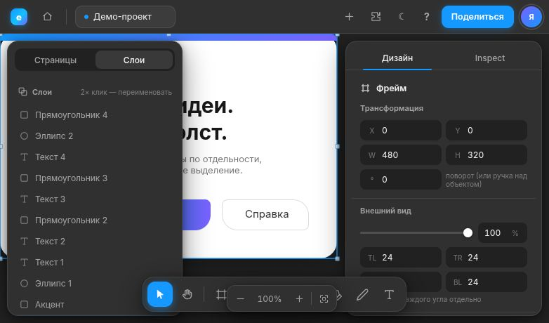

# eMake&Draw

Локальный офлайн-редактор дизайна в духе «мини-Figma»: страницы, слои, фреймы, фигуры, текст, градиенты, поворот, группы, экспорт и собственные плагины. Работает без регистрации, серверов и интернета.



## Возможности

- **Инструменты:** выделение, рука, фрейм, прямоугольник, эллипс, линия, перо, карандаш, текст.
- **Трансформации:** перемещение, 8 ручек ресайза, поворот (Shift — шаг 15°), стрелки для точного сдвига, Alt+drag — дубликат.
- **Стили:** сплошная заливка и градиент с углом, обводка, скругление каждого угла отдельно, прозрачность, тень, размытие.
- **Текст:** редактирование прямо на холсте, размер, вес, выравнивание, многострочность.
- **Структура:** страницы, слои, группы (включая вложенные), порядок слоёв, скрытие, переименование.
- **Удобства:** направляющие привязки, выделение рамкой, выравнивание нескольких объектов, вкладки файлов, тёмная и светлая тема, шаблоны «Лендинг» и «Мобильный экран».
- **Экспорт:** `.emdraw`, PNG (1×/2×/4×, прозрачный или цветной фон), SVG, HTML-просмотр, CSS в панели Inspect.
- **Импорт:** `.emdraw`, `.empl`, изображения drag-and-drop.
- **Плагины:** пункты контекстного меню, кнопки в тулбаре, доступ к объектам и выделению.

## Быстрый старт

### Готовая сборка

Соберите приложение под свою платформу:

```bash
npm install
npm run dist:linux   # rpm + deb + AppImage
npm run dist:win     # NSIS + portable exe
npm run dist:all     # Linux + Windows
```

Готовые файлы появятся в `dist/`.

### Из исходников

```bash
npm install
npm start
```

Требуется Node.js 18+ и npm. Приложение использует Electron 31.

## Горячие клавиши

| Действие | Клавиши |
|---|---|
| Выделение / рука | `V` / `H` |
| Фрейм / прямоугольник / эллипс | `F` / `R` / `O` |
| Текст / линия / перо / карандаш | `T` / `L` / `P` / `B` |
| Дублировать / группа / разгруппировать | `Ctrl+D` / `Ctrl+G` / `Ctrl+Shift+G` |
| Копировать / вставить | `Ctrl+C` / `Ctrl+V` |
| Отменить / повторить | `Ctrl+Z` / `Ctrl+Shift+Z` |
| Сохранить / сохранить как | `Ctrl+S` / `Ctrl+Shift+S` |
| Вписать всё / выделение / 100% | `Shift+1` / `Shift+2` / `Shift+0` |
| Закончить перо / отменить | `Enter` / `Esc` |
| Точный сдвиг | стрелки, `Shift` — 10 px |

## Формат проекта

`.emdraw` — обычный JSON:

```json
{
  "app": "eMake&Draw",
  "version": 9,
  "name": "Мой проект",
  "pages": [
    {
      "id": "page-id",
      "name": "Страница 1",
      "objects": [
        {
          "id": "object-id",
          "type": "rect",
          "name": "Прямоугольник 1",
          "x": 100, "y": 100, "w": 240, "h": 160,
          "rotation": 0, "opacity": 1, "visible": true,
          "fill": "#0d99ff", "stroke": "#ffffff", "strokeWidth": 0,
          "radius": 16, "radii": null, "grad": null,
          "shadow": false, "blur": 0, "textAlign": "left"
        }
      ]
    }
  ]
}
```

Типы объектов: `frame`, `rect`, `ellipse`, `line`, `pen`, `pencil`, `text`, `image`, `group`.

Дополнительные поля:

- текст — `text`, `fontSize`, `fontWeight`;
- линия, перо, карандаш — `points`;
- группа — `children`;
- изображение — `src` (data URL).

## Плагины `.empl`

Плагин — JSON с полями `app`, `version`, `name`, `desc`, `code`. Код выполняется в контексте страницы через `new Function("api", code)` и получает объект `api`.

| API | Назначение |
|---|---|
| `api.ids`, `api.selection` | идентификаторы и объекты текущего выделения |
| `api.page`, `api.file` | текущая страница и файл |
| `api.create(type, props)` | создать объект |
| `api.update(id, props)` | изменить объект, включая вложенные группы |
| `api.remove(ids)` | удалить объекты, включая вложенные |
| `api.duplicate(ids, dx, dy)` | дублировать объекты |
| `api.getSelection()` | копии выделенных объектов |
| `api.select(ids)` | изменить выделение |
| `api.each(fn)` | пройти по объектам страницы |
| `api.hsl(h, s, l)` | получить HEX-цвет |
| `api.toast(text)` | показать уведомление |
| `api.theme("light" \| "dark")` | переключить тему |
| `api.addMenuItem(title, fn)` | добавить пункт в контекстное меню |
| `api.addToolButton(title, emoji, fn)` | добавить кнопку в тулбар |

Пример:

```js
api.addToolButton("Конфетти", "🎉", a => {
  for (let i = 0; i < 24; i++) {
    const s = 10 + Math.random() * 18;
    a.create("ellipse", {
      x: Math.random() * 800,
      y: Math.random() * 500,
      w: s, h: s,
      fill: a.hsl(Math.floor(Math.random() * 360), 85, 60)
    });
  }
  a.toast("🎉");
});
```

> **Важно:** плагины выполняют произвольный JavaScript. Запускайте только те `.empl`, которым доверяете.

## Где хранятся данные

- **Автосохранение:** `localStorage`, ключ `emdraw_v9`. В нём лежат открытые файлы, страницы, слои, зум и путь к последнему сохранённому файлу.
- **Основное хранилище:** файлы `.emdraw` на диске. Для проектов с изображениями сохраняйте их в `.emdraw`: base64-картинки могут быстро исчерпать квоту localStorage.
- **Плагины:** `localStorage`, ключ `emdraw_plugins_v3`.

## Ограничения

- Нет облачной совместной работы, компонентов с экземплярами, Auto Layout, булевых операций, прототипирования и импорта `.fig`.
- Текст автоматически подстраивает ширину и высоту под содержимое; поля W/H для текста носят справочный характер.
- Изображения добавляются перетаскиванием на холст — отдельной кнопки «Изображение» пока нет.
- Буфер обмена объектов внутренний, не системный.
- Плагины не изолированы: это доверенные локальные скрипты.

## Лицензия

MIT. См. [LICENSE](LICENSE).
